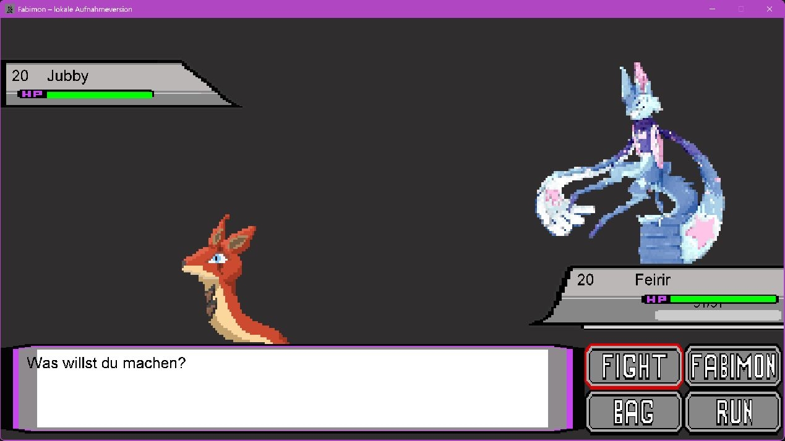
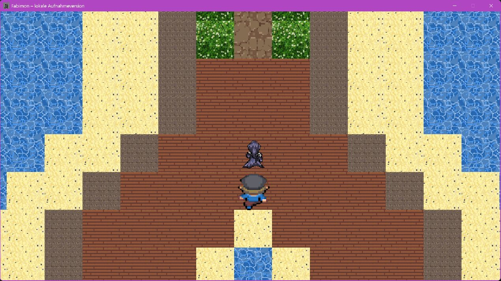
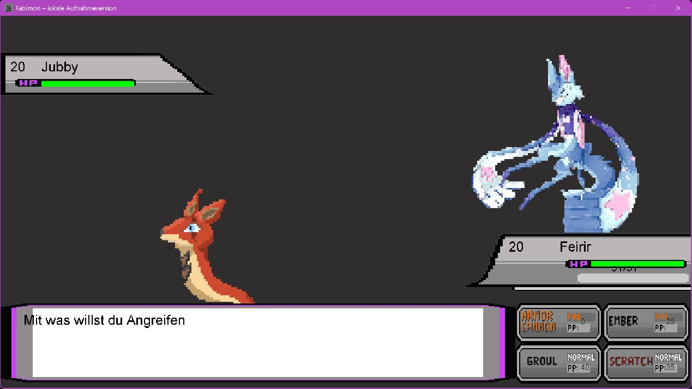
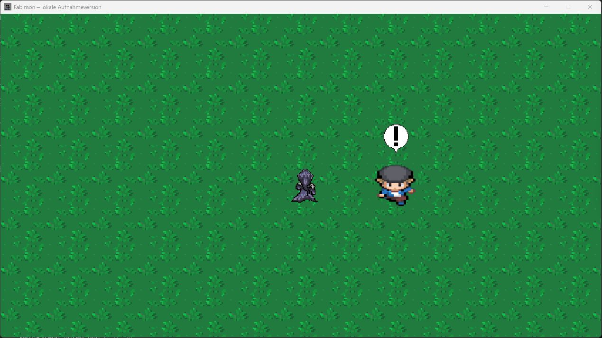
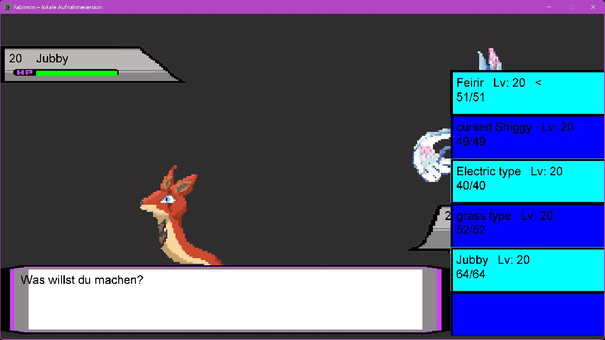

# Fabimon

**2D-Rollenspiel · Teamprojekt im Abitur · TGI12 / 2023**

Ein Java-Spiel mit eigener Tile-Welt, Fabimon-Team und rundenbasierten Kämpfen. Das Projekt verbindet Bewegung und NPC-Begegnungen mit Attacken, Charakterwerten, Items und Spielständen.

[Projekt und Technik](docs/PROJEKT.md) · [Bildergalerie](docs/GALERIE.md) · [Quellcode herunterladen](https://github.com/Kennatris/Fabimon_Project/archive/refs/heads/master.zip)

## Einblick

| Arena | Attackenauswahl |
| --- | --- |
|  |  |

| Trainerbegegnung | Teamwechsel |
| --- | --- |
|  |  |

Für die Aufnahmen wurden Figuren positioniert und Animationen angehalten. [Weitere Bilder](docs/GALERIE.md).

## Was umgesetzt wurde

- Tile-basierte Welt mit Kamera, Kollisionen, NPCs und Kartenwechseln.
- Rundenbasiertes Kampfsystem mit Attacken, Werten und Teamwechsel.
- Teamübersicht, Statusseite und Inventar mit Heilitems.
- Drei auswählbare Spielstände sowie Video- und Soundeinstellungen.

## Start und Bedienung

Die Anleitung zum Kompilieren und Starten steht in der [Projektdokumentation](docs/PROJEKT.md#kompilieren-und-starten). Java-Klassen und Ressourcen müssen gemeinsam verfügbar sein; das Arbeitsverzeichnis ist der Projektordner.

| Eingabe | Aktion |
| --- | --- |
| W/A/S/D oder Pfeiltasten | Bewegung und Menüauswahl |
| Enter oder Leertaste | Bestätigen und NPC-Interaktion |
| Escape | Pause bzw. zurück |

> **Hinweis:** Dokumentation und Zusammenfassung wurden automatisiert durch einen Agenten erstellt und dienen der Veranschaulichung. Der Spielcode ist unverändert. Alle Angaben und Downloads ohne Gewähr.
