# Fabimon – Galerie

Kämpfe, Trainerbegegnungen, Arena und Spielwelt. Für die folgenden Aufnahmen wurden Figuren positioniert und Animationen angehalten.

## Kampfsystem

Im Kampf stehen Attacken, Teamwechsel und Items zur Auswahl.

## Attackenauswahl

Attacken mit Typ und verfügbaren AP.

## Teamwechsel

Auswahl eines Fabimon aus dem eigenen Team.

## Kampfbeginn

Der Übergang von der Spielwelt in den Kampf.

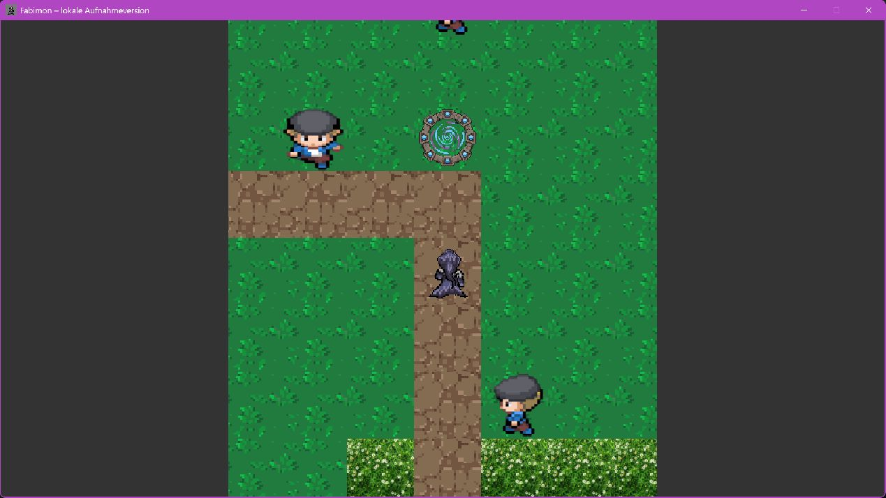

## Trainerbegegnung

Ein Trainer bemerkt die Spielfigur.

## Arena

Wege, Strand und Wasser auf der Arenakarte.

## Kampfrunde

Kampftext nach einer Aktion.

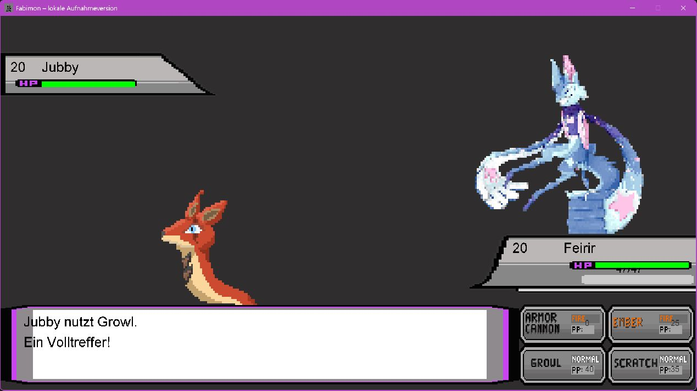

## Figurenanimation

Die Fabimon sind im Kampf animiert.

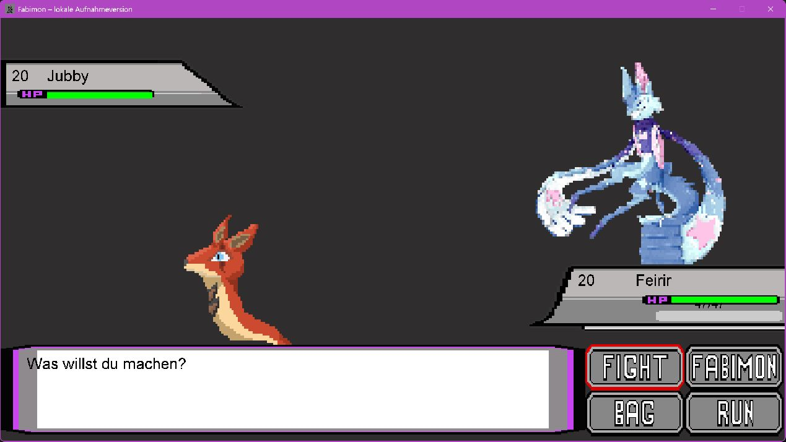

## Items im Kampf

Gegenstände lassen sich über den Beutel auswählen.

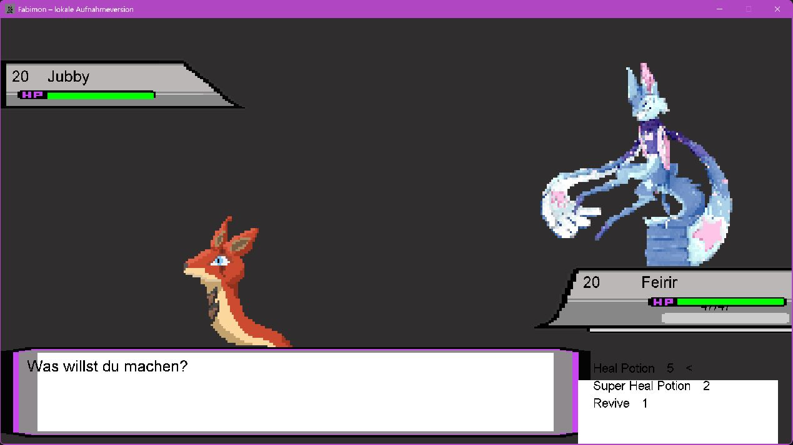

## Heilzentrum

Heilung der eigenen Fabimon in der Spielwelt.

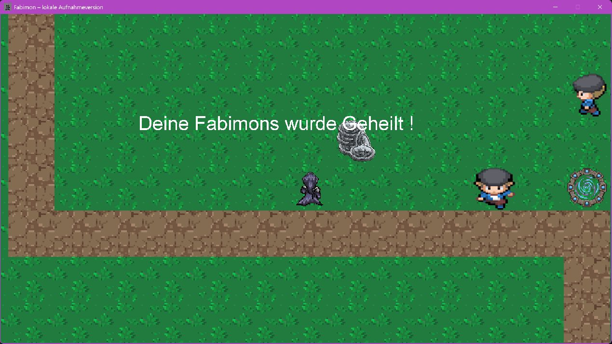

## NPC-Gespräch

Textdialoge mit Figuren in der Welt.

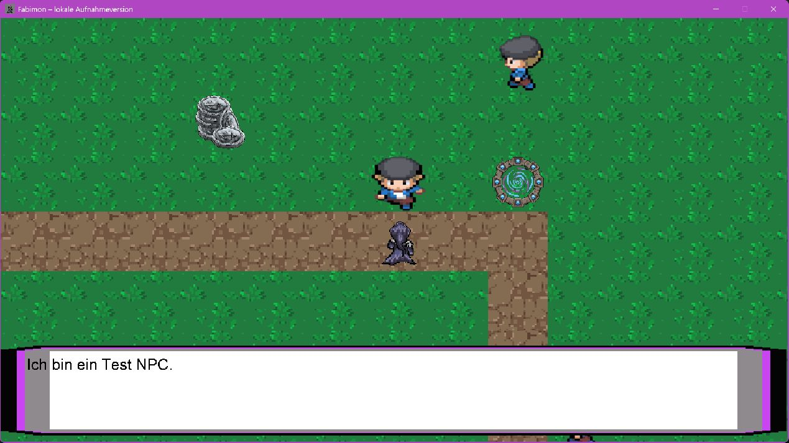

## Spielwelt mit Portal

Die Spielfigur zwischen NPCs, Wegen und einem Portal.

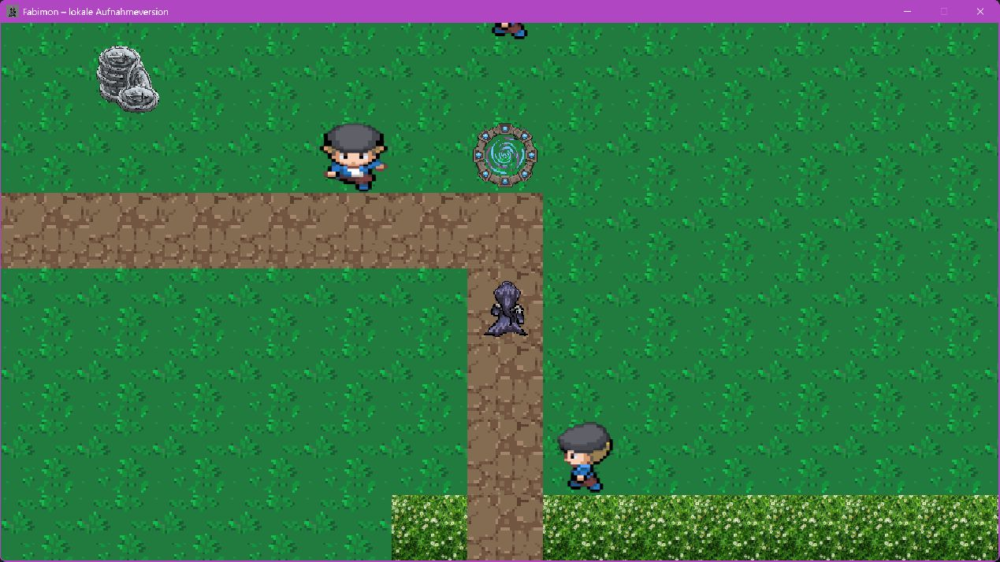

Titelbildschirm, Menüs, Inventar und Team

Diese Bilder zeigen das normal laufende Spiel.

## Titelbildschirm

Das Hauptmenü mit Spielstandauswahl, Spielstart und Einstellungen.

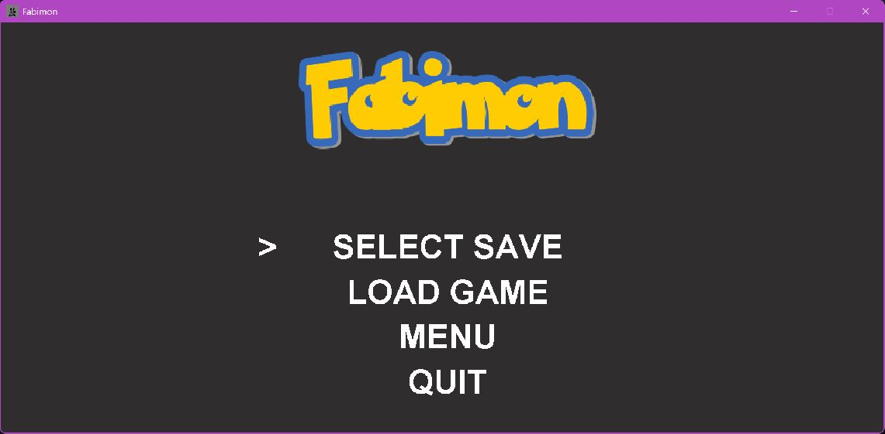

## Spielstandauswahl

Drei Speicherplätze stehen zur Auswahl.

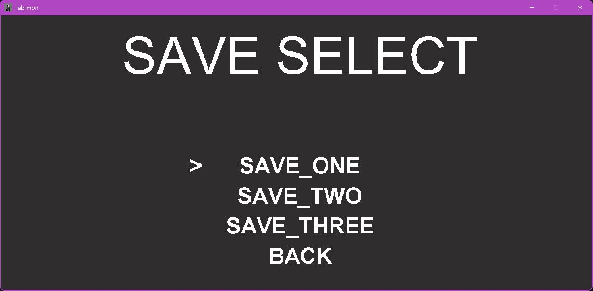

## Einstellungen

Video, Sound und Eingabemodus.

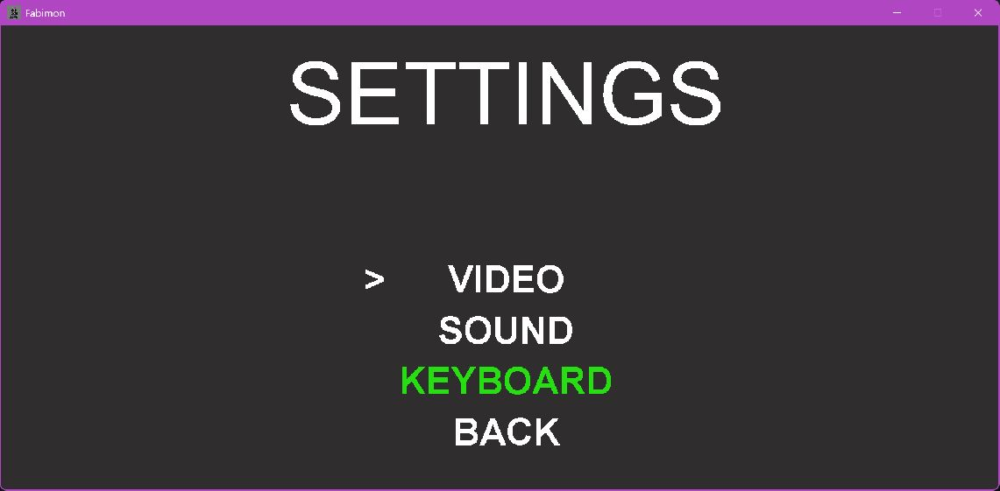

## Video

Die Vollbildoption im Einstellungsmenü.

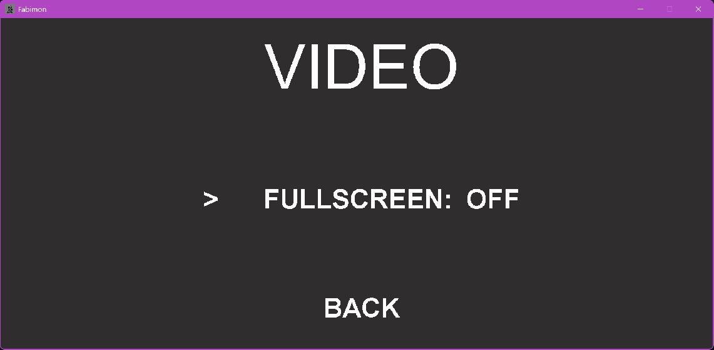

## Sound

Musik- und Effektlautstärke.

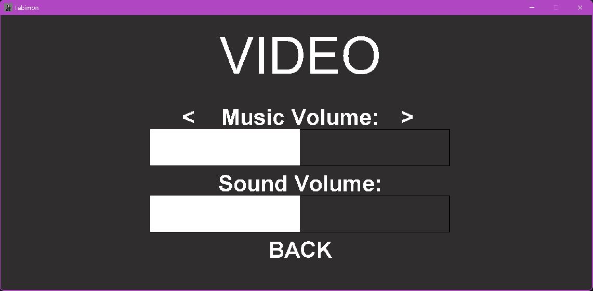

## Spielwelt

Die Spielfigur auf einem Weg durch die Tile-Welt.

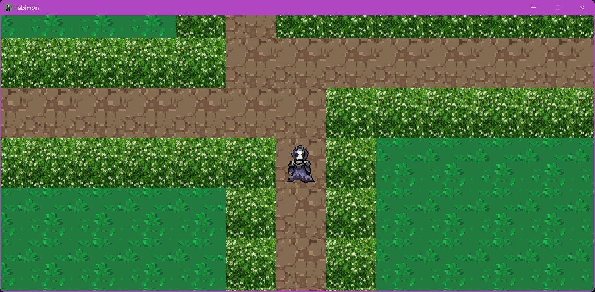

## Pause

Zugriff auf Inventar, Team und Speichern.

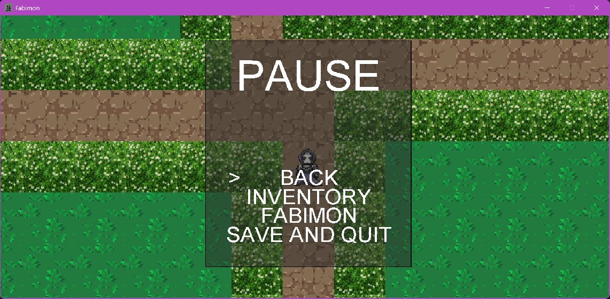

## Inventar

Items und ihre Mengen.

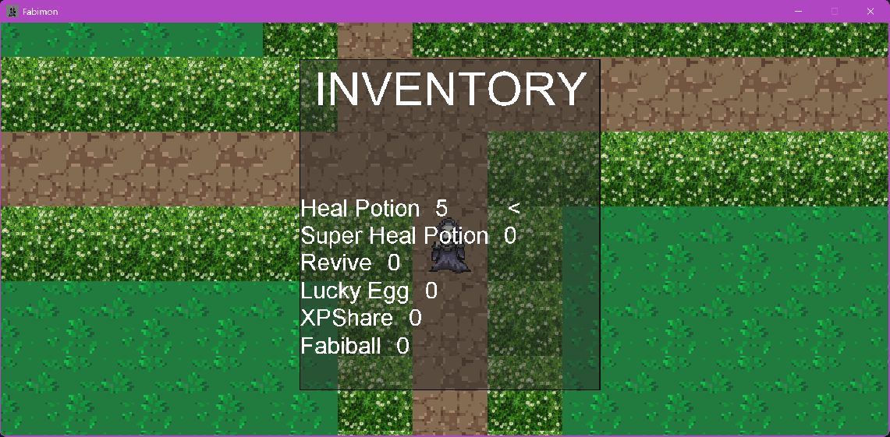

## Fabimon-Team

Teamplätze mit Level und Lebenspunkten.

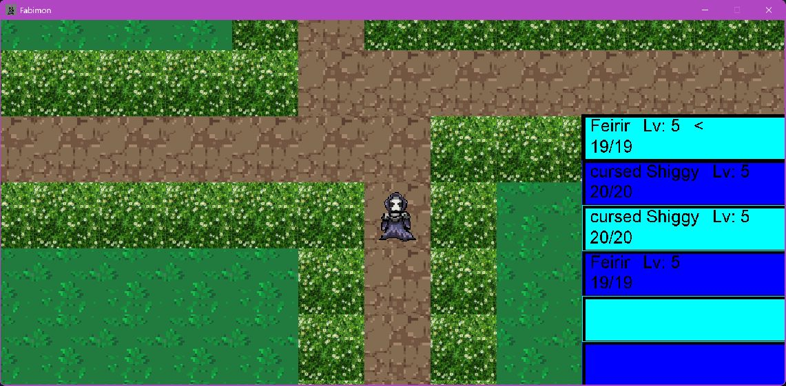

## Teamoptionen

Aktionen für das ausgewählte Fabimon.

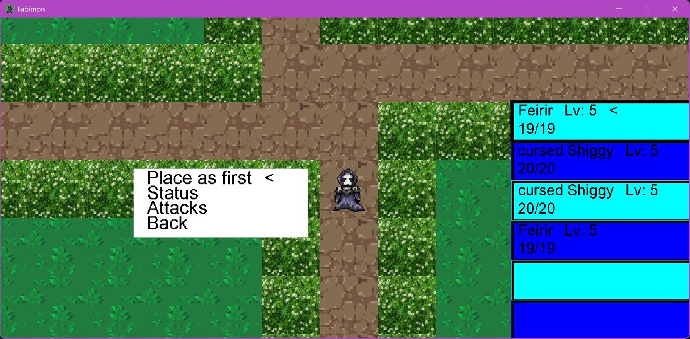

## Statusansicht

Die Detailansicht eines Fabimon.

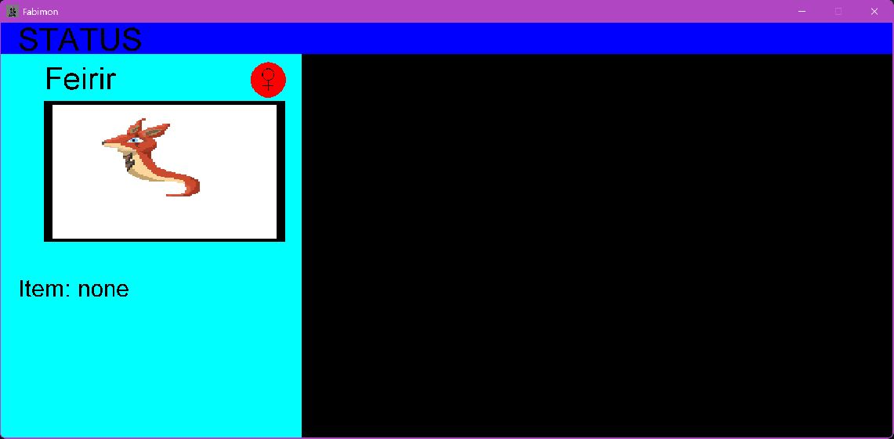

[Projekt und Technik](PROJEKT.md) · [Zur Übersicht](../README.md). Alle Angaben und Downloads ohne Gewähr.
