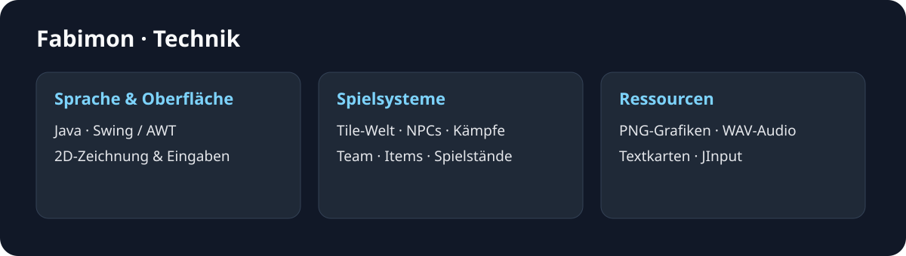

# Fabimon – Projekt und Technik

## Entstehung

Fabimon entstand 2023 als gemeinsame Projektarbeit im Abitur (TGI12). Ziel war ein eigenes 2D-Rollenspiel mit einer begehbaren Welt und rundenbasierten Kämpfen.

## Spielidee und Umfang

Die Spielfigur bewegt sich durch eine Tile-Welt und begegnet NPCs und Trainern. Jedes Fabimon besitzt Lebenspunkte, ein Level, Werte und Attacken. Das Kampfsystem verwaltet eigene und gegnerische Aktionen, Teamwechsel und Items. Spielwelt, Kampf, Dialog, Heilung, Pause, Inventar und Teamansicht werden als unterschiedliche Zustände dargestellt.

Die Bildauswahl in der [README](../README.md) zeigt einen kurzen Einblick. Die [Galerie](GALERIE.md) enthält die aufgenommenen Ansichten einschließlich Menüs und Teamdetails.

## Architektur



| Bereich | Umsetzung |
| --- | --- |
| Einstieg und Spielschleife | `src/main/Main.java`, `GameHandler` |
| Fenster und Darstellung | Swing-Fenster, AWT/Graphics2D, `UI`, `ImageHandler` |
| Welt und Kollisionen | `tile/TileManager`, `CollisionChecker`, Textkarten |
| Figuren und Begegnungen | `entity/Player`, `NPCTest`, `AssetSetter`, `EventHandler` |
| Fabimon und Kämpfe | `entity/Fabimon`, `Battle/Battle`, einzelne Attackenklassen |
| Gegenstände | `src/Items` mit verschiedenen Heilitem-Klassen |
| Spielstände | `settings/SaveCompiler`, Textdateien unter `res/saves` |
| Eingaben und Audio | Tastatur, JInput, Java Sound/WAV |

## Dateien und Ressourcen

Das Spiel umfasst **60 Java-Dateien**. Unter `res` liegen Grafiken, Musik, Karten, Dialoge, Charakterwerte, Attackenlisten und Spielstände. Die JInput- und JUtils-Bibliotheken befinden sich im Projektordner. `Documentation` enthält die damaligen Projektunterlagen.

## Kompilieren und starten

Das Spiel wurde unter Windows mit **Temurin JDK 21.0.13+9** kompiliert und gestartet. Die folgenden PowerShell-Befehle werden im Projektordner ausgeführt; `javac` und `java` müssen erreichbar sein. Die kompilierten Klassen werden im temporären Verzeichnis abgelegt.

```powershell
$classes = Join-Path ([IO.Path]::GetTempPath()) 'fabimon-classes'
New-Item -ItemType Directory -Force -Path $classes | Out-Null
$sources = @(Get-ChildItem -LiteralPath src -Recurse -Filter *.java | ForEach-Object FullName)
$libs = 'jinput-2.0.9.jar;jutils-1.0.0.jar'
javac -proc:none -encoding UTF-8 -cp $libs -d $classes @sources
java -cp "$classes;res;$libs;jinput-platform-2.0.7-natives-windows.jar" main.Main
```

Im Titelbildschirm zuerst unter **SELECT SAVE** einen vorhandenen Speicherplatz auswählen, über **BACK** zurückkehren und anschließend **LOAD GAME** wählen. Bewegung und Menüauswahl erfolgen mit W/A/S/D oder den Pfeiltasten, Bestätigen und NPC-Interaktion mit Enter oder Leertaste. Escape öffnet die Pause bzw. führt zurück. Das Pausenmenü bietet Inventar und Teamansicht.

## Spielstände und Einstellungen

Die Anwendung liest Karten, Dialoge und Spielstände über relative Dateipfade. Beim Start muss deshalb der Projektordner das Arbeitsverzeichnis sein. Einstellungen und Spielfortschritt werden unter `res/saves` gespeichert. Für einen eigenen Durchlauf lässt sich der gesamte Projektordner kopieren.

Die Bedienung ist auf Tastatur ausgelegt. Eine Controller-Anbindung über JInput ist ebenfalls im Code enthalten.

## Bilder

Die [Galerie](GALERIE.md) zeigt Kämpfe, Arena, Trainerbegegnungen und Menüs. Für die Kampf- und Weltaufnahmen wurden Figuren positioniert und Animationen angehalten. Die Darstellung stammt aus dem Spiel.

[Zur Projektübersicht](../README.md). Alle Angaben und Downloads ohne Gewähr.
